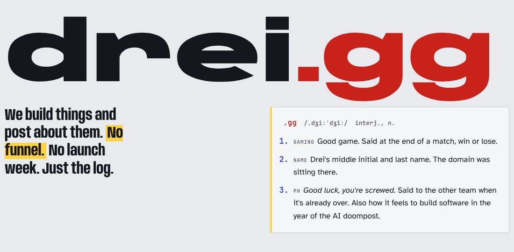
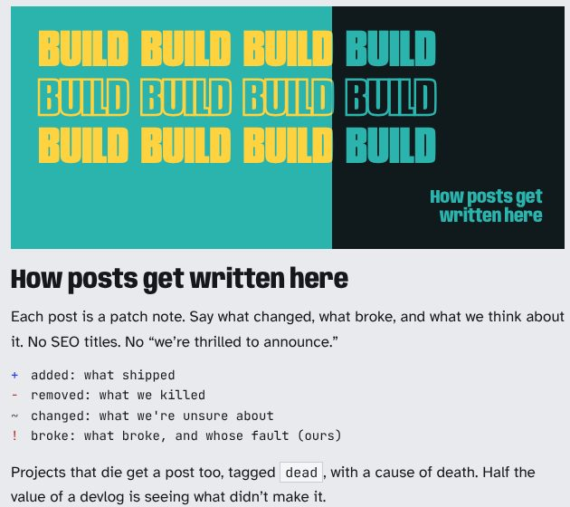
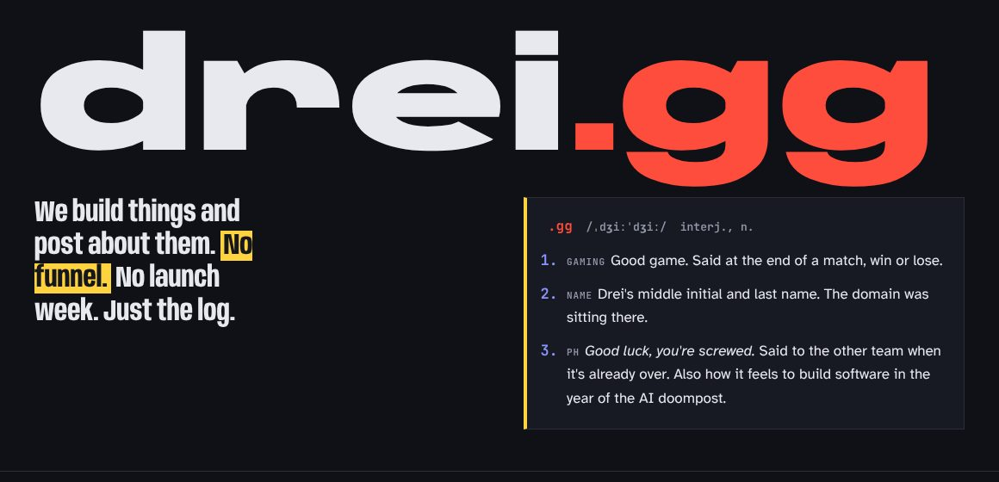

```callout
Heads up
Callouts are for the one thing a reader shouldn't miss. First line is the heading, the rest is the body.
```

```aeris
Built on Aeris
Same as a callout, in teal. Use it for workstation notes, setup, anything that happened on the machine.
```

```pull
The tools got absurdly good, so the only sane move is to ship more weird things.
-- drei
```

```bignum
80%
of this site was typed by something that isn't me. The other 20% was arguing with it about blue.
```

```shout
gg
```

```shout
new
new
new
shop? no
```

```tape
No funnel. No launch week. Just the log.
```

```notes
+ added: what shipped
- removed: what we killed
~ changed: what we're unsure about
! broke: what broke, and whose fault (ours)
```

## Framed images








